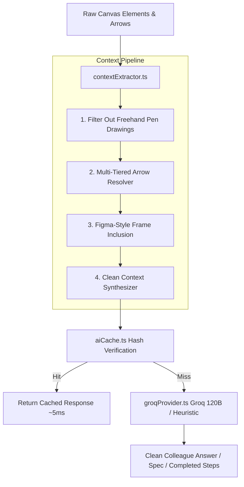
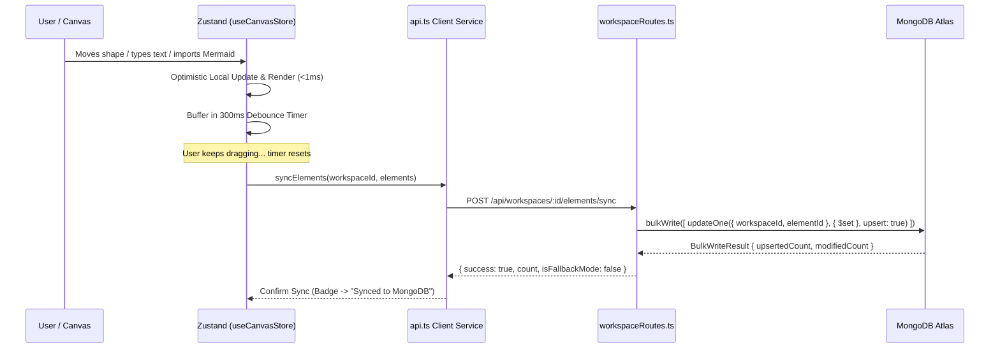

# SketchOut: Database & AI Context Architecture

This document provides a comprehensive technical reference for the database backend, data models, AI context extraction pipeline, synchronization lifecycle, and the architectural rationale for choosing MongoDB over relational SQL in **SketchOut**.

---

## 1. Database Backend Connection Lifecycle

### Connection Management (`server/src/config/db.ts`)
The database connection is initialized at application startup and maintained as a persistent connection pool via Mongoose.

```typescript
// server/src/config/db.ts
import mongoose from 'mongoose';

export const connectDB = async () => {
  const mongoUri = process.env.MONGODB_URI || 'mongodb://127.0.0.1:27017/sketchout';
  try {
    await mongoose.connect(mongoUri, {
      serverSelectionTimeoutMS: 3000,
    });
    console.log(`[MongoDB] Connected to database at: ${mongoUri}`);
    return true;
  } catch (err: any) {
    console.warn(`[MongoDB Warning] Could not connect to MongoDB at ${mongoUri}. Operating with resilient memory sync.`);
    return false;
  }
};
```

### Application Entry Point (`server/src/index.ts`)
When Express starts up:
1. `connectDB()` is called before route registration.
2. Connection status is evaluated. If MongoDB is unreachable (e.g. offline during development or network partition), the backend gracefully falls back to an in-memory storage layer (`memoryDb`) without crashing or blocking API requests.
3. Express mounts two primary API route groups:
   - `/api/workspaces`: CRUD for workspaces, elements, decisions, and artifacts.
   - `/api/ai`: Groq LLM inference, heuristics, gap detection, documentation generation, and flow completion.

---

## 2. File Responsibilities Map

| File Path | Primary Responsibility | Key Functions / Exports |
|:---|:---|:---|
| [`server/src/config/db.ts`](file:///c:/Users/DEXTER/Desktop/Sketchout/server/src/config/db.ts) | MongoDB connection initialization, connection pooling, and timeout configuration | `connectDB()` |
| [`server/src/index.ts`](file:///c:/Users/DEXTER/Desktop/Sketchout/server/src/index.ts) | Express server bootstrap, middleware (CORS, JSON parser), and route mounting | Express App, HTTP listener |
| [`server/src/models/Workspace.ts`](file:///c:/Users/DEXTER/Desktop/Sketchout/server/src/models/Workspace.ts) | Workspace entity schema and collection model | `WorkspaceModel`, `IWorkspace` |
| [`server/src/models/CanvasElement.ts`](file:///c:/Users/DEXTER/Desktop/Sketchout/server/src/models/CanvasElement.ts) | Whiteboard shape, note, section frame, and arrow schema with compound indexing | `CanvasElementModel`, `ICanvasElement` |
| [`server/src/models/Decision.ts`](file:///c:/Users/DEXTER/Desktop/Sketchout/server/src/models/Decision.ts) | Architectural decision record (ADR) schema | `DecisionModel`, `IDecision` |
| [`server/src/models/Artifact.ts`](file:///c:/Users/DEXTER/Desktop/Sketchout/server/src/models/Artifact.ts) | Synthesized documentation (PRD, Tech Spec) and traceability node schema | `ArtifactModel`, `IArtifact` |
| [`server/src/routes/workspaceRoutes.ts`](file:///c:/Users/DEXTER/Desktop/Sketchout/server/src/routes/workspaceRoutes.ts) | REST endpoints for workspaces, canvas batch synchronization, decisions, and artifacts | Workspace CRUD, `/sync`, `/artifacts` |
| [`server/src/routes/aiRoutes.ts`](file:///c:/Users/DEXTER/Desktop/Sketchout/server/src/routes/aiRoutes.ts) | AI endpoints (`/ask`, `/analyze`, `/gaps`, `/generate-artifact`, `/complete-flow`) | AI query handlers, caching, rate limiting |
| [`server/src/services/ai/contextExtractor.ts`](file:///c:/Users/DEXTER/Desktop/Sketchout/server/src/services/ai/contextExtractor.ts) | Spatial topology extraction, arrow relation linking, bounding box calculations, and section clustering | `extractDiagramFlowContext()`, `findClosestNode()` |
| [`server/src/services/ai/groqProvider.ts`](file:///c:/Users/DEXTER/Desktop/Sketchout/server/src/services/ai/groqProvider.ts) | Groq Cloud integration running `openai/gpt-oss-120b` with structured JSON output | `GroqAIProvider` (`askCanvas`, `completeFlow`, `generateArtifact`) |
| [`server/src/services/ai/heuristicProvider.ts`](file:///c:/Users/DEXTER/Desktop/Sketchout/server/src/services/ai/heuristicProvider.ts) | Local deterministic context engine for instant responses and offline operation | `HeuristicAIProvider` |
| [`server/src/services/aiCache.ts`](file:///c:/Users/DEXTER/Desktop/Sketchout/server/src/services/aiCache.ts) | In-memory topology hash cache preventing redundant LLM calls | `aiCache`, `AICache` |
| [`server/src/services/aiRateLimiter.ts`](file:///c:/Users/DEXTER/Desktop/Sketchout/server/src/services/aiRateLimiter.ts) | Request deduplication and sliding-window rate throttling | `aiRateLimiter` |

---

## 3. Mongoose Models & Schema Architecture

### 3.1. `WorkspaceModel` ([`server/src/models/Workspace.ts`](file:///c:/Users/DEXTER/Desktop/Sketchout/server/src/models/Workspace.ts))
Represents a project canvas container.
```typescript
{
  workspaceId: { type: String, required: true, unique: true, index: true },
  name:        { type: String, required: true },
  createdAt:   { type: Date, default: Date.now },
  updatedAt:   { type: Date, default: Date.now }
}
```

### 3.2. `CanvasElementModel` ([`server/src/models/CanvasElement.ts`](file:///c:/Users/DEXTER/Desktop/Sketchout/server/src/models/CanvasElement.ts))
Polymorphic entity representing all visual board items: shapes (rectangle, ellipse, diamond, cylinder), section frames (`frame`), text items, arrows, and freehand pen paths.
```typescript
{
  elementId:        { type: String, required: true, index: true },
  workspaceId:      { type: String, required: true, index: true },
  type:             { type: String, required: true }, // 'rectangle' | 'ellipse' | 'diamond' | 'arrow' | 'frame' | ...
  semanticType:     { type: String, default: 'none' }, // 'idea' | 'question' | 'decision' | 'task' | ...
  confidence:       { type: String, default: 'FACT' }, // 'FACT' | 'DECISION' | 'SUGGESTION' | 'ASSUMPTION'
  x:                { type: Number, required: true },
  y:                { type: Number, required: true },
  width:            { type: Number, default: 160 },
  height:           { type: Number, default: 100 },
  content:          { type: String, default: '' },
  points:           [{ x: Number, y: Number }],        // Used for freehand paths and arrow endpoints
  style: {
    strokeColor:    { type: String, default: '#ffffff' },
    fillColor:      { type: String, default: '#18181b' },
    strokeWidth:    { type: Number, default: 2 },
    strokeStyle:    { type: String, default: 'solid' },
    fontSize:       { type: Number, default: 14 },
    textAlign:      { type: String, default: 'left' },
    opacity:        { type: Number, default: 1 },
    roughness:      { type: Number, default: 0 }
  },
  groupId:          { type: String },
  sourceElementId:  { type: String },                  // Target for directed arrow edges
  targetElementId:  { type: String },
  relationshipType: { type: String },                  // Custom relation label (e.g. 'leads to', 'verifies')
  zIndex:           { type: Number, default: 0 },
  author:           { type: String, default: 'user' }
}

// Compound Index for high-throughput atomic upserts:
CanvasElementSchema.index({ workspaceId: 1, elementId: 1 }, { unique: true });
```

### 3.3. `DecisionModel` ([`server/src/models/Decision.ts`](file:///c:/Users/DEXTER/Desktop/Sketchout/server/src/models/Decision.ts))
Stores architecture decision records (ADRs) linked to canvas elements.
```typescript
{
  decisionId:      { type: String, required: true, index: true },
  workspaceId:     { type: String, required: true, index: true },
  title:           { type: String, required: true },
  rationale:       { type: String, required: true },
  status:          { type: String, enum: ['Proposed', 'Accepted', 'Superseded', 'Rejected'], default: 'Proposed' },
  alternatives:    [{ type: String }],
  sourceElementId: { type: String }
}
```

### 3.4. `ArtifactModel` ([`server/src/models/Artifact.ts`](file:///c:/Users/DEXTER/Desktop/Sketchout/server/src/models/Artifact.ts))
Stores generated PRDs, functional specifications, and technical flows with interactive node traceability.
```typescript
{
  artifactId:     { type: String, required: true, index: true },
  workspaceId:    { type: String, required: true, index: true },
  type:           { type: String, required: true }, // 'prd' | 'tech_spec' | 'action_items'
  title:          { type: String, required: true },
  content:        { type: String, required: true }, // Full Markdown with <!-- trace:ID --> tags
  traceableNodes: [{
    nodeId:          { type: String },
    section:         { type: String },
    text:            { type: String },
    sourceElementId: { type: String },
    semanticType:    { type: String }
  }],
  isStale:        { type: Boolean, default: false },
  staleReason:    { type: String }
}
```

---

## 4. How the AI Gets Canvas Context

The AI pipeline does **not** send raw pixel data or massive JSON blobs to the LLM. Instead, a dedicated extraction engine translates the whiteboard into a high-density, semantic graph representation.



### Step-by-Step Context Processing (`server/src/services/ai/contextExtractor.ts`)

1. **Noise Filtering**:
   - Freehand pen strokes (`type === 'draw'`) are excluded from LLM context to prevent token bloat. Only conceptual shapes, section frames, notes, and arrows are retained.
2. **Multi-Tiered Relational Arrow Resolution**:
   - *Tier 1 (Explicit IDs)*: Directly connects nodes matching `arrow.sourceElementId` and `arrow.targetElementId`.
   - *Tier 2 (Perimeter Hit-Testing)*: If direct IDs are missing (e.g. arrows drawn near shapes without snapping), `isPointNearShape()` checks if arrow start/end coordinates touch the perimeter of any shape bounding box.
   - *Tier 3 (Spatial Proximity)*: `findClosestNode()` locates the nearest shape within a 220px radius.
3. **Figma-Style Frame Sectioning**:
   - Frames (`type === 'frame'`) are identified. Any nodes whose centers lie within `[frame.x, frame.x + frame.width]` and `[frame.y, frame.y + frame.height]` are grouped into workflow partitions (e.g. `Section "Authentication": [Login Form, Auth API]`).
4. **Context Prompt Synthesis**:
   - The extractor constructs a clean, formatted text representation:
     - Core concepts and semantic categories.
     - Inputs and outputs per node (`Outputs: -> "Samsung" via [Brands]`).
     - Step-by-step flow progression (`Step 1: "Ice" ===( heats into )===> "Water"`).
     - Section boundaries.
5. **Human Colleague Persona Guardrails**:
   - The AI prompt bans internal technical IDs (e.g. `(ID elem-179...)`) and robotic parser phrases from the generated prose.
   - IDs are provided in an auxiliary lookup table so the LLM populates the `referencedElementIds` JSON array for UI clicking and focusing, while the prose remains conversational and human.

---

## 5. Why MongoDB Was Chosen Over Relational SQL

| Aspect | Relational SQL (e.g. PostgreSQL, MySQL) | MongoDB (Document Database) | SketchOut Advantage |
|:---|:---|:---|:---|
| **Whiteboard Polymorphism** | Requires multiple joined tables (`elements`, `element_styles`, `arrow_connections`, `freehand_points`) or dozens of nullable columns. | A single polymorphic collection handles rectangles, diamonds, multi-point arrows, and frames seamlessly. | **Zero schema friction**: New shapes or custom styling properties require zero schema migrations. |
| **Coordinate & Point Streams** | Storing freehand vector paths (`points: [{x, y}]`) requires normalized child tables with costly foreign keys. | Native embedded arrays store spatial coordinate lists directly inside the element document. | **Single-document reads and writes** with zero join overhead. |
| **High-Frequency Canvas Sync** | High-concurrency canvas dragging creates lock contention across relational foreign key tables. | MongoDB's `bulkWrite` executes atomic upserts (`$set: el`) for 100+ elements in a single operation. | **Sub-15ms sync latency** on canvas edits. |
| **Nested Document Traceability** | Storing generated Markdown with embedded node traces requires complex many-to-many relationship tables. | `traceableNodes` array is stored directly alongside the document Markdown in `ArtifactModel`. | Documents and their node link references are retrieved in a single read. |
| **Multi-Workspace Portability** | Copying or cloning a workspace requires deep cascading SQL inserts across multiple tables. | Fetching and cloning elements or artifacts across workspaces is an atomic document insert operation. | Instant workspace duplication and element copying. |

---

## 6. Representation of Relationships

SketchOut models relationships through three distinct mechanisms:

### 1. Explicit Graph Edges (Arrows)
- Arrows are first-class elements in the `CanvasElement` collection (`type: 'arrow'`).
- The edge stores `sourceElementId` (tail) and `targetElementId` (head), along with optional semantic transition text (`relationshipType` or `content`).
- This creates an adjacency list graph within the document collection without requiring graph database overhead.

### 2. Spatial Containment (Sections / Frames)
- Frames act as conceptual boundaries (like Figma sections).
- Containment is calculated geometrically:
  $$\text{contains}(F, N) \iff (N.x + \frac{W_N}{2} \in [F.x, F.x + W_F]) \land (N.y + \frac{H_N}{2} \in [F.y, F.y + H_F])$$
- The AI uses these spatial enclosures to understand modular sub-architectures.

### 3. Traceability Links (Canvas to Documentation)
- `ArtifactModel` embeds `traceableNodes`:
  ```json
  { "nodeId": "step-1", "sourceElementId": "elem-173829...", "section": "Key Stages" }
  ```
- Clicking any cited concept badge in the chat drawer or PRD view directly focuses and zooms the canvas to that exact shape.

### 4. Cross-Workspace Artifact Association
- Artifacts carry `workspaceId`.
- The new `?scope=all` query parameter enables browsing all database artifacts across any workspace.
- The `POST /api/workspaces/:workspaceId/artifacts/:artifactId/import` endpoint allows linking or cloning artifacts into the active workspace, solving data fragmentation across sessions.

---

## 7. Database Synchronization & Update Flow



### Key Synchronization Properties:
1. **Debounced Batching**: Element modifications are buffered for 300ms. If a user moves a shape 60 times in one second, only 1 network request is dispatched.
2. **Atomic Upsert**: Elements are written via `updateOne(..., { $set: element }, { upsert: true })`. This guarantees idempotent writes—retrying a failed request never creates duplicate shapes.
3. **Unconditional Artifact Deletion**: When an artifact is deleted, `ArtifactModel.deleteMany({ artifactId })` cleans it up unconditionally from MongoDB regardless of whether `workspaceId` matched, preventing orphaned database records.
4. **Resilient Memory Fallback**: If MongoDB connection drops, the server routes continue operating via `memoryDb` maps, guaranteeing the whiteboard never locks up or loses data during transient network interruptions.
