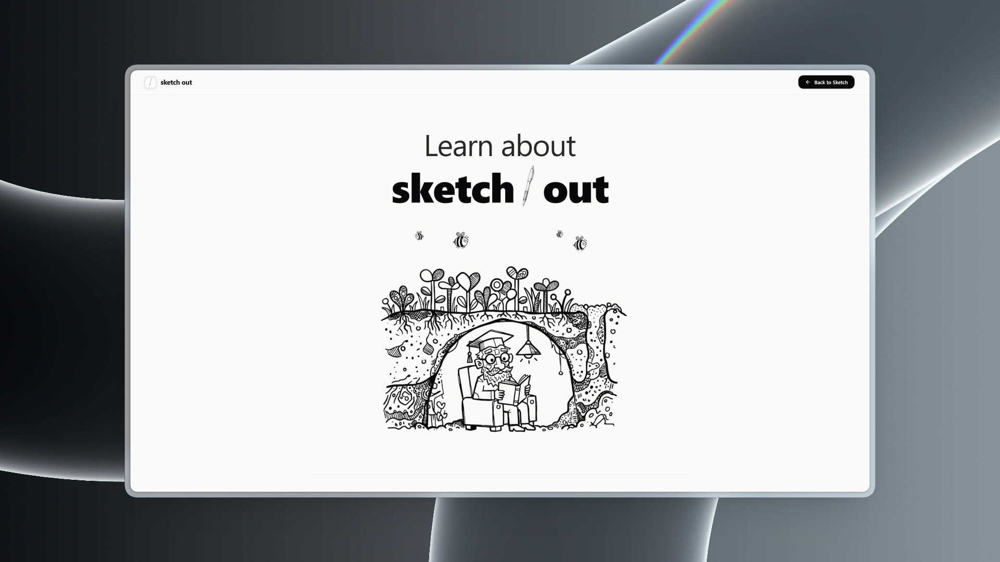
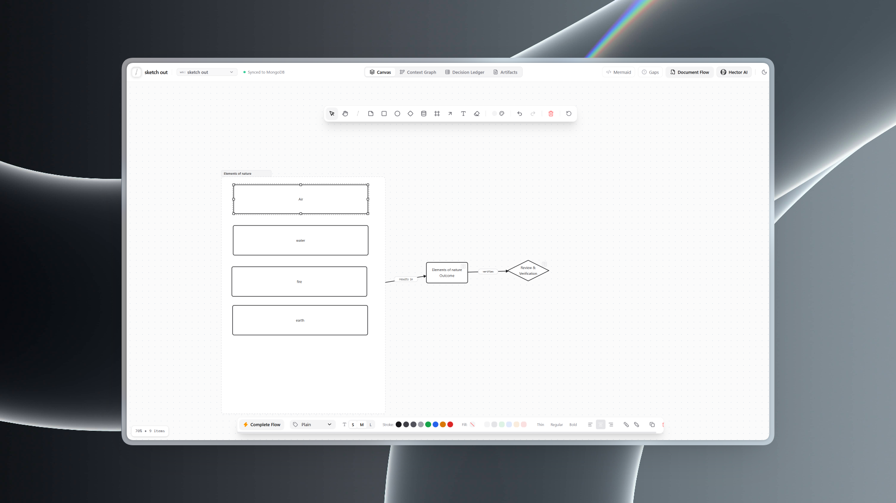
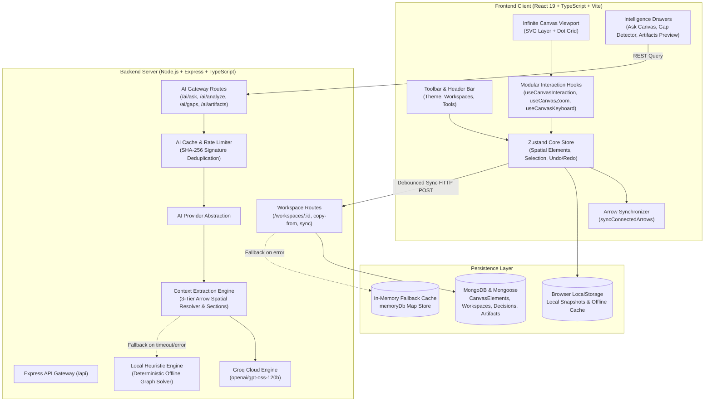

# SketchOut

> **Context-Aware Visual Thinking & Execution Workspace**  
> A high-performance spatial whiteboard that transforms visual brainstorming and architectural diagrams into executable living documentation, structured decisions, and AI-synthesized specifications.

<p align="center">
  
</p>

<p align="center">
  
</p>

---

## Overview

Traditional whiteboard tools treat diagrams as passive pixels and disconnected vectors. **SketchOut** bridges spatial thinking and software execution: every geometric node, sticky note, connector, and section boundary feeds into a continuous **Semantic Context Graph**. 

Powered by Groq Cloud's ultra-fast **`openai/gpt-oss-120b`** reasoning engine with automatic offline heuristic fallback, SketchOut acts as a genuine human co-designer—understanding systemic relationships, spotting missing requirements, and generating traceable engineering deliverables without robotic parser jargon.

---

## Key Features

- **Infinite 2D Viewport**: Freeform canvas with hardware-accelerated 60fps pan and non-linear cursor-centered zoom ($10\% - 500\%$).
- **Figma-Style Sections (`F`)**: Visual boundary containers with top header tab pills. Enclosed child elements move together as cohesive workflows and provide scoped sub-contexts for AI reasoning.
- **Dynamic Connector Engine (`A`)**: 3-tier spatial resolution (explicit ID bindings $\to$ perimeter boundary curve hit-testing $\to$ $220\text{px}$ proximity fallback) with live anchor snap recalculation.
- **Dual-Mode Colleague AI (`Ask Canvas`)**:
  - **Casual & Essence Mode** (Default): Discusses the human story, creative intent, metaphors, and essence of what was sketched without reciting internal IDs or diagram shape jargon.
  - **Technical & Deep Mode**: Focuses on system architecture, service boundaries, data flow, protocols, state transitions, and engineering trade-offs.
- **Traceable Living Artifacts**: Synthesize production-grade PRDs, Architecture Specs, and Action Item ledgers with clickable bidirectional trace tags (`<!-- trace:NODE_ID -->`) linked directly to canvas nodes.
- **Documentation Drift Detection**: Automatically alerts designers and engineers when canvas nodes are modified or deleted after a specification was generated.
- **Multiple Workspaces & Cross-Workspace Copy**: Create, rename, switch between, and borrow flows across isolated workspaces without overwriting existing boards.
- **Non-Destructive JSON Import/Export**: Merges imported diagrams cleanly alongside existing canvas work with automatic spatial offsetting and collision-free ID remapping.
- **Zero-Friction Offline-First Reliability**: Operates transparently with 100% functionality even when MongoDB or external API keys are unavailable via built-in in-memory fallback caches.

---

## Architecture Overview



---

## Project Structure

```
Sketchout/
├── client/                     # Frontend Application
│   ├── src/
│   │   ├── components/
│   │   │   ├── ai/             # Ask Canvas Drawer, Gap Detector, Artifacts Preview
│   │   │   ├── canvas/         # InfiniteCanvas, CanvasElementView, Geometry & Hooks
│   │   │   │   └── hooks/      # useCanvasInteraction, useCanvasKeyboard, useCanvasZoom, useTextEditing
│   │   │   └── layout/         # HeaderBar, Toolbar, Navigation Tabs
│   │   ├── services/           # REST API client
│   │   ├── store/              # Zustand Store & Arrow Synchronizer
│   │   ├── types/              # Canvas, Element & Viewport TypeScript definitions
│   │   └── utils/              # Theme adaptive colors & math helpers
│   └── vite.config.ts          # Vite configuration with auto-backend daemon spawner
├── server/                     # Backend API Service
│   ├── src/
│   │   ├── models/             # Mongoose Models (Workspace, CanvasElement, Decision, Artifact)
│   │   ├── routes/             # Express API Routes (workspaces, ai)
│   │   └── services/           # Context Engine, Groq Provider, Heuristic Provider, AI Cache
│   └── tsconfig.json
├── package.json                # Monorepo task runner
├── .env.example                # Sample environment variables
└── README.md
```

---

## Tech Stack

| Layer | Technology |
| :--- | :--- |
| **Frontend Framework** | React 19, Vite, TypeScript |
| **Styling & Icons** | Tailwind CSS v4, Lucide React, Monochrome B&W Design System |
| **State Management** | Zustand (spatial elements, transactional undo/redo, auto-sync) |
| **Backend Framework** | Node.js v20+, Express, TypeScript (ES Modules) |
| **Database** | MongoDB with Mongoose ORM & In-Memory `memoryDb` Fallback |
| **AI Reasoning Engine** | Groq Cloud API (`openai/gpt-oss-120b`) with Deterministic Heuristic Fallback |

---

## Quick Start

### 1. Prerequisites
- **Node.js** v18+ (v20+ recommended)
- **npm** or **pnpm**
- **MongoDB** (Optional: the app automatically falls back to in-memory mode if MongoDB is not running)

### 2. Installation
Clone the repository and install all dependencies:
```bash
git clone https://github.com/BhriguKumarDeka/sketchout.git
cd sketchout
npm run install:all
```

### 3. Environment Configuration (Optional)
Copy the example environment configuration:
```bash
cp .env.example .env
cp server/.env.example server/.env
```

To enable full cloud AI reasoning, add your [Groq API Key](https://console.groq.com/):
```env
PORT=5000
MONGODB_URI=mongodb://127.0.0.1:27017/sketchout
GROQ_API_KEY=gsk_your_groq_api_key_here
GROQ_MODEL=openai/gpt-oss-120b
```
*(If no API key or MongoDB is provided, SketchOut runs completely offline via local graph heuristics).*

### 4. Running the Development Server
```bash
npm run dev
```
- **Web App**: `http://localhost:5173`
- **Backend API**: `http://localhost:5000`

---

## Canvas Shortcuts & Controls

| Shortcut | Tool / Action |
| :---: | :--- |
| `V` | **Select Tool** — Click to select, drag to marquee or translate elements |
| `H` | **Hand Tool** — Pan canvas smoothly across infinite coordinates |
| `Space` + Drag | **Quick Pan** — Temporarily activate panning from any tool |
| `F` | **Section / Frame Tool** — Draw visual container boundaries to group flows |
| `R` | **Rectangle** |
| `O` | **Ellipse** |
| `D` | **Diamond** (Decision Node) |
| `C` | **Cylinder** (Database / Storage) |
| `S` | **Sticky Note** (Brainstorming Idea) |
| `A` | **Connector Arrow** — Drag between elements to establish directional flow |
| `P` | **Freehand Pen** — Sketch and annotate |
| `T` | **Text Box** |
| `E` | **Eraser** — Click elements to delete |
| `Ctrl + Z` / `Ctrl + Y` | **Undo / Redo** |
| `Ctrl + D` | **Duplicate Selection** |
| `Del` / `Backspace` | **Delete Selection** |
| `[` / `]` | **Send Backward / Bring Forward** |
| `Ctrl + Scroll` | **Zoom In / Out** (Centered at cursor) |
| `0` / `1` | **Reset Zoom (100%) / Zoom to Fit Content** |

---

## API Reference Summary

| Method | Endpoint | Description |
| :--- | :--- | :--- |
| `GET` | `/api/workspaces` | List all available workspaces |
| `POST` | `/api/workspaces` | Create a new isolated workspace |
| `GET` | `/api/workspaces/:id` | Fetch workspace data, elements, decisions, and artifacts |
| `POST` | `/api/workspaces/:id/elements/sync` | Debounced batch synchronization of canvas elements |
| `POST` | `/api/workspaces/:id/copy-from/:sourceId` | Clone elements from another workspace without overlap |
| `GET` | `/api/ai/status` | Check AI engine status (Groq Cloud vs Local Heuristic) |
| `POST` | `/api/ai/ask` | Ask questions in **Casual & Essence** or **Technical & Deep** mode |
| `POST` | `/api/ai/analyze` | Evaluate decisions, action items, risks, and assumptions |
| `POST` | `/api/ai/gaps` | Detect orphaned concepts, circular loops, and missing steps |
| `POST` | `/api/ai/generate-artifact` | Synthesize living PRDs or specs with bidirectional trace links |
| `DELETE` | `/api/workspaces/:id/artifacts/:artifactId` | Remove redundant or stale generated documentation |

---

## License

Distributed under the MIT License. See `LICENSE` for more information.
